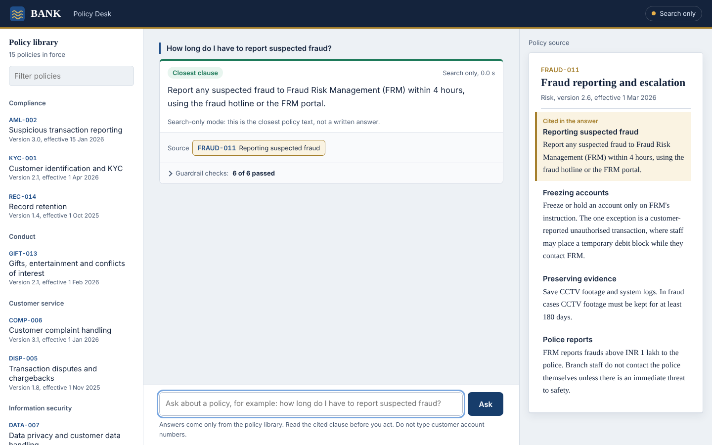
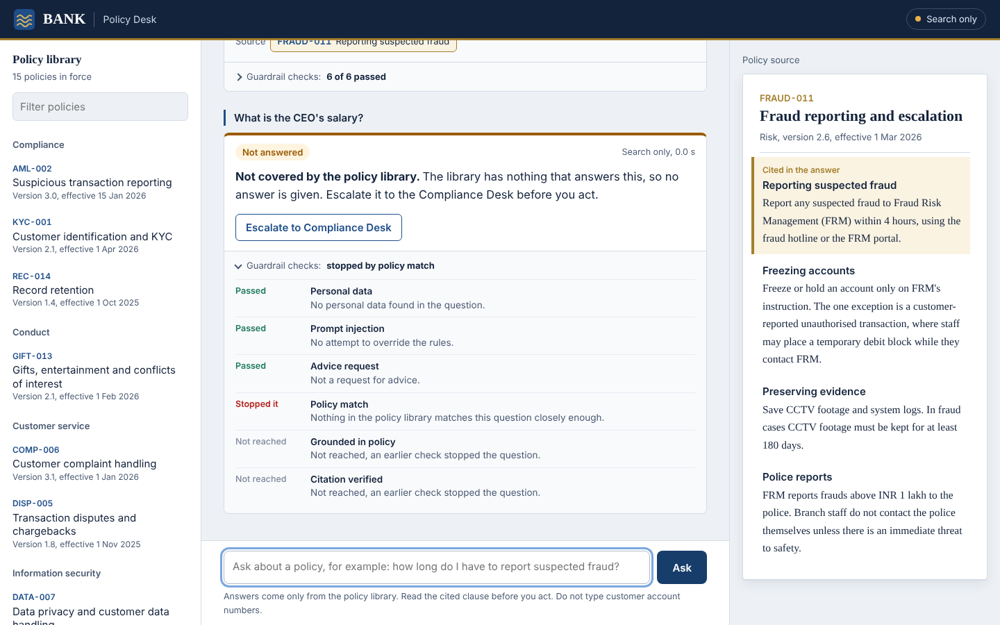

# BANK Policy Desk

**An AI policy assistant for bank staff that answers only from approved policies, cites the exact clause, and refuses or escalates when it should.**

Operations and compliance staff lose time searching long policy documents, and a confident wrong answer in a bank is worse than no answer. Policy Desk uses retrieval-augmented generation (RAG) so every answer comes from a real policy clause, and six guardrail checks run on every question. Everything here is fictional: the bank, the policies and the numbers. Built by Srinivas Pranav K as a learning and portfolio project, using only the Python standard library. OpenRouter writes the answers and Gemini powers the meaning-based search.



*Screenshots are taken in search-only mode (no API key). With an OpenRouter key, the answer is written by an AI model from the retrieved clauses.*

## What it does

- Answers questions such as "How long do I have to report suspected fraud?" from 15 fictional policies, and opens the cited clause on the right so the user can read it.
- **Says "not covered" instead of guessing** when the policies do not contain the answer.
- **Hides personal data**: PAN, Aadhaar, card and long account numbers are masked before anything else sees the question, including the log.
- **Refuses prompt-injection and advice requests**, and lets the user **escalate** to the Compliance Desk with a logged ticket.
- Shows the result of every guardrail check under each answer, so a reviewer can see why it answered or refused.



## How it works

```
question
   |
   v
1 Personal data     mask PAN / Aadhaar / card / long numbers
2 Prompt injection  block "ignore your rules" style requests
3 Advice request    block investment, legal and tax advice -> escalate
4 Policy match      keyword + meaning search finds the closest clauses; too weak -> "not covered"
   |  top 4 clauses
   v
   an AI model (via OpenRouter) writes a short answer using ONLY those clauses (or says it cannot)
   |
5 Grounded          the model must say the clauses contain the answer
6 Citation          the answer must cite clauses that were really retrieved, or it is withheld
   |
   v
answer + source clause  (every question is written to an audit log with personal data masked)
```

**Retrieval.** Each policy is split into clauses (one per heading). Gemini turns each clause into an embedding (a list of numbers that captures meaning), saved in `.cache/`. A question is embedded the same way and compared by cosine similarity. That score is blended with a keyword score, so exact terms like "PAN" or "INR 50,000" still count. Without an API key the app falls back to keyword search only.

**Generation.** The model gets only the top clauses and temperature 0, and is told to reply with one JSON object `{answerable, answer, sources}`. Free models are less tidy than paid ones, so the app extracts the JSON even if the model adds code fences or extra words, and retries once if it cannot read the reply. The prompt tells the model to treat the question and clauses as data, never as instructions.

**Why the guardrails are plain code.** Checks 1 to 4 and 6 do not depend on the model behaving. Even if the model were tricked, an answer that cites nothing real is withheld.

## The AI gateway

Every question goes through `gateway.py`, a layer around the guardrails that a real bank platform would also need. It has no framework and keeps its state in one SQLite file (`.cache/gateway.db`).

| Part | What it does | Why it matters in a bank |
|---|---|---|
| **Semantic cache** | If a new question means the same as a saved one, the saved answer is returned and the AI is not called. A hit needs the same policy version, the same numbers, the same best clause, the same key words and a close enough meaning. | Saves cost and quota, and the guards stop a stale or wrong answer being reused ("within 4 hours" vs "24 hours", "savings" vs "current"). Changing any policy clears every saved answer. Refusals are never cached. |
| **Token budget** | Each team has a daily token allowance. Each request is trimmed to a size cap by dropping the lowest-ranked clauses. When the allowance is gone the request is refused with a clear reason. | Cost control and fair use. Counts come from the provider when it reports them, otherwise they are estimated at about 4 characters per token. |
| **Model routing** | Plain rules, not AI, pick a small or large model: long questions, several questions in one, and comparison or exception words add points. If the first model fails, a fallback model is tried. | Cheap model for easy lookups, stronger model for hard ones, and an explainable reason logged for every choice. |
| **Hybrid retrieval** | Keyword and meaning search are blended (`RETRIEVAL=weighted`, the tuned default), or fused by rank (`RETRIEVAL=rrf`, reciprocal rank fusion). | `evals/gateway_evals.py` compares both so the choice rests on a number. |
| **Async batch jobs** | `POST /api/jobs` takes up to 200 questions and returns a job id at once. A background worker answers them with retries and a pause between calls, and stops early if the provider keeps failing. The same idempotency key never creates a duplicate job. | Overnight or bulk work without a user waiting. Jobs survive a restart. |
| **Observability** | Every request gets a trace id (also returned in the `X-Trace-Id` header) and a timing for each step. The dashboard at `/ops` shows requests, answered rate, cache hit rate, median and 95th percentile time, tokens, notional cost, route mix, refusal reasons and recent requests. | Answers "why was this slow, expensive or refused?" and gives an audit trail. |

Open the dashboard at http://localhost:8000/ops. A rate limit (10 questions a minute per user by default) sits in front of the API.

**When the AI provider is down or out of quota**, the web app does not show an error. It shows the closest policy clause with a short notice, marks the request `degraded` on the dashboard, and never saves that stand-in to the cache. A daily-limit error (HTTP 429, `per-day`) is not retried, because retrying cannot help. Batch jobs and evals do not use the stand-in: they still see the error, so jobs retry and evals report "inconclusive" instead of passing on a fake answer.

The pipeline order with the gateway: guardrails 1 to 3, retrieval, **cache**, **budget and routing**, model call, guardrails 5 and 6, **save to cache**, log.

## Run it

Python 3.9 or newer. No packages to install.

```bash
git clone https://github.com/BackstreetGamer98/bank-rag-project.git
cd bank-rag-project
cp .env.example .env        # then put your keys in .env (never commit it)
python3 app.py              # open http://localhost:8000
```

You need two keys, both free to get:

- `OPENROUTER_API_KEY` from [openrouter.ai](https://openrouter.ai) writes the answers. `OPENROUTER_MODEL` defaults to `openrouter/free`, a router that picks a currently available free model. Free models change often and have rate limits, so set a specific model id in `.env` if you want consistent behaviour. If you get a "data policy" error, check the privacy settings on your OpenRouter account.
- `GEMINI_API_KEY` from [aistudio.google.com](https://aistudio.google.com) powers the meaning-based search. It is optional: without it the search uses keywords only.

Without an OpenRouter key the app still runs in search-only mode and shows the closest clause.

## Tests and evaluation

```bash
python3 -m unittest discover -s tests -v   # 63 tests, no key or internet needed
python3 evals/run_evals.py                 # scores 41 questions, writes evals/results.md
python3 evals/gateway_evals.py             # routing, cache safety and retrieval, writes evals/gateway_results.md
```

A GitHub Actions workflow (`.github/workflows/tests.yml`) runs the unit tests and both evals on every push, in search-only mode with no keys. The build fails if routing is wrong, if the cache gives a wrong answer, or if the keyword baseline gets worse.

`evals/questions.csv` holds 31 answerable questions (with the expected policy and a key fact) and 10 questions that must be refused (out of scope, advice, prompt injection). The score that matters most is **wrong answers given instead of refusing**, which must be 0. The script exits with an error if it ever is not.

Baseline without an AI model (keyword search only): 27 of 31 answerable questions correct, 9 of 10 refused correctly. The misses are paraphrased questions that keyword search cannot match, and one out-of-scope question ("branch Wi-Fi password") that shares a word with a real policy. Run the evals with your keys to measure the full pipeline; the latest run is saved in `evals/results.md`. The runner pauses between questions to respect free-tier rate limits, so a full run takes about 4 minutes.

**Provider errors are not wrong answers.** If the AI provider fails (rate limit, no quota), the question is reported as *inconclusive*, never as a pass or a wrong answer, and the run stops early after 3 failures in a row. The exit code is 1 for wrong answers, 2 if some questions were inconclusive, 0 when everything was decided. OpenRouter free models allow 50 requests a day (1,000 after a one-time purchase of $10 of credits) and 20 a minute, so a full AI run uses most of a free day. Use `--limit 10` to run only the first 10 questions.

**Gateway evals.** `evals/gateway_evals.py` checks that 13 questions go to the right model tier, and, with a Gemini key, that paraphrased questions reuse a saved answer while near-miss questions (savings vs current, hours vs days, high-risk vs low-risk) never do. The routing rules were tuned on those 13 questions, so treat the score as a regression test and not as proof of general accuracy.

## Tuning refusals

`KW_MIN` (default 0.40) and `SEM_MIN` (default 0.55) in `.env` set how close a question must be to a policy before the model is asked at all. Change one, rerun the evals, and compare. That loop is how the defaults were chosen.

## Add your own policies

Add a Markdown file to `docs/`:

```markdown
---
code: HR-016
title: Leave policy
category: Conduct
version: 1.0
effective: 2026-01-01
---
## Annual leave
Staff get 20 days of annual leave a year.
```

Restart the app. Each `##` heading becomes one searchable clause.

## Files

| File | Purpose |
|---|---|
| `rag.py` | Loading, chunking, search, guardrails, AI calls (OpenRouter and Gemini), audit log, escalation |
| `gateway.py` | Semantic cache, token budget, model routing, batch jobs, tracing and metrics |
| `app.py` | Small local web server, API and rate limit |
| `ui/index.html` | The interface (library, conversation, source viewer) |
| `ui/ops.html` | The operations dashboard and batch form |
| `docs/` | The 15 fictional policies |
| `tests/` | Guardrail, gateway and rate-limit tests |
| `evals/` | Test questions, routing and cache-pair cases, scoring scripts |
| `.github/workflows/` | Runs tests and evals on every push |

## Honest limits

- Injection and advice detection use phrase patterns, so a clever rewording can slip past them. The citation and grounding checks are the stronger layer.
- Search is over 58 short clauses. A real bank would need a vector database, document versioning and access control by role.
- Logs are plain files and the gateway uses one SQLite file. A real deployment needs a proper database, access control and retention rules.
- The gateway has no login: the team name comes from an `X-Team` header. A real gateway would take it from the user's identity.
- With free models, "cost" is a notional demo price, and the large and small model are the same unless you set `MODEL_LARGE` and `MODEL_SMALL`.
- The cache avoids the obvious wrong reuse (different numbers, clause or key words), but a very short, ambiguous question could still reuse an answer wrongly. Raise `CACHE_SIMILARITY` to be stricter.
- Not security-reviewed and not for real customer data.

See also [BankGuard](https://github.com/BackstreetGamer98/bankguard), a separate project that guards what an AI agent is allowed to *do*, while this one guards what an assistant is allowed to *say*.

## Licence

MIT. See `LICENSE`.
